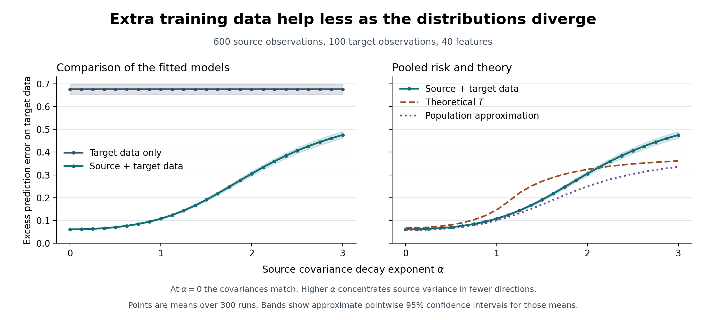

# Covariate Shift Lab

## Summary

For my master's thesis, I used Python to test how much extra training data from a different distribution can improve predictions. Across 25 simulated scenarios, I compared a linear regression fit trained on a small target dataset with one that also used a larger source dataset.

Adding source data improved target predictions on average in all 25 scenarios. The reduction in **excess prediction error** fell from **91% when the distributions matched** to **30% at the strongest shift tested**.



The left panel compares the two fitted models. The right panel compares the simulated pooled risk with the theoretical quantity $T$ and the population approximation. The shaded bands show Monte Carlo uncertainty in the means over 300 runs per setting.

## Simulation setup

Each observation follows $Y=X^\top\beta+\varepsilon$, with the same coefficient vector $\beta=(1,\ldots,1)^\top/\sqrt p$ in both domains and independent Gaussian noise $\varepsilon\sim\mathcal N(0,\sigma^2)$. The simulation uses $\sigma=1$. The covariates are centered Gaussian with target covariance $\Sigma_T=I_p$ and diagonal source covariance $\Sigma_S$. The source eigenvalues are

$$
\lambda_{S,j}=p\,\frac{j^{-\alpha}}{Z_\alpha},
\qquad
Z_\alpha=\sum_{k=1}^p k^{-\alpha},
\qquad j=1,\ldots,p.
$$

At $\alpha=0$, both covariances equal $I_p$. As $\alpha$ increases, more of the source variance is concentrated in the first few coordinates. The source trace stays at $p$, so the sweep changes how the variance is distributed across coordinates while holding total variance fixed. The experiment uses 25 equally spaced values of $\alpha$ between 0 and 3.

In each repetition, I fit ordinary least squares to the target sample and to the two samples stacked together. Both fits use the same target observations. The target sample for a given repetition is also reused across the sweep, which gives the same target-only baseline at each $\alpha$.

For each fitted coefficient vector $\hat\beta$, I compute **target excess risk**, the increase in expected squared prediction error on a fresh target observation compared with knowing the true $\beta$. The known target covariance and coefficient vector give the following expression for this risk.

$$
R_T(\hat\beta)=(\hat\beta-\beta)^\top\Sigma_T(\hat\beta-\beta).
$$

Here $\Sigma_T=I_p$, so this is the squared Euclidean distance between the fitted and true coefficient vectors.

## The theoretical quantity

$T(n,m,\alpha,p)$ summarizes the scale of pooled target excess risk at unit noise variance.

| Parameter | Meaning | Value in the experiment |
| --- | --- | --- |
| $n$ | Number of source observations | 600 |
| $m$ | Number of target observations | 100 |
| $\alpha$ | Decay exponent of the source covariance spectrum | 0 to 3 |
| $p$ | Number of features | 40 |

Let $S_j=j^{-\alpha}/Z_\alpha$ and $T_j=1/p$ be the fractions of source and target variance in coordinate $j$. Both covariance matrices have trace $p$, so $nS_j$ and $mT_j$ are proportional to the expected contributions of the two samples to the pooled Gram matrix in that direction. The set $J^c$ contains the coordinates where the source contributes at least as much as the target. The number $d$ counts the remaining coordinates.

```math
J^c=\{j:nS_j\ge mT_j\},
\qquad
J=\{1,\ldots,p\}\setminus J^c,
\qquad
d=|J|.
```

Then

```math
\begin{aligned}
T(n,m,\alpha,p)
&=\frac d m+\frac1n\sum_{j\in J^c}\frac{T_j}{S_j}\\
&=\sum_{j=1}^p\min\left\{\frac{T_j}{nS_j},\frac1m\right\}\\
&=\sum_{j=1}^p\frac{T_j}{\max\{nS_j,mT_j\}}.
\end{aligned}
```

For each coordinate, $T$ takes the smaller of the source risk term $T_j/(nS_j)$ and the target risk term $T_j/(mT_j)=1/m$. Both have the same numerator $T_j$, so the smaller risk term comes from the larger expected information contribution in the denominator.

### Comparison curves

The pooled OLS fit uses the realized Gram matrix $G=X_S^\top X_S+X_T^\top X_T$. At unit noise variance, the expected target excess risk conditional on that design is $\mathrm{tr}(\Sigma_T G^{-1})$. The **population pooled approximation** is a deterministic risk curve obtained by replacing $G$ by its expectation before inversion.

$$
\mathrm{tr}\left(\Sigma_T(n\Sigma_S+m\Sigma_T)^{-1}\right)
=\sum_{j=1}^p\frac{T_j}{nS_j+mT_j}.
$$

The expected risk of pooled OLS averages over the realized designs after inversion. Matrix inversion is convex in the positive semidefinite order, so $(\mathbb E[G])^{-1}\preceq\mathbb E[G^{-1}]$. The population approximation is therefore a lower bound on the expected pooled risk.

The population approximation sums the source and target information in each coordinate, while $T$ uses their maximum. Since the sum is between one and two times the maximum, the population approximation lies between $T/2$ and $T$ in this setup.

The **target-only Wishart benchmark** is the exact expected target excess risk of target-only least squares under the Gaussian design, $\sigma^2 p/(m-p-1)$ for $m>p+1$. It equals 0.678 here.

## Results and interpretation

| Source decay $\alpha$ | Mean target-only risk | Mean pooled risk | Pooled reduction | $T$ | Population pooled approximation |
| ---: | ---: | ---: | ---: | ---: | ---: |
| 0.0 | 0.676 | 0.061 | 91% | 0.067 | 0.057 |
| 1.5 | 0.676 | 0.191 | 72% | 0.272 | 0.170 |
| 3.0 | 0.676 | 0.475 | 30% | 0.361 | 0.335 |

When the covariances match, the extra source observations provide information in every coordinate. At $\alpha=3$, the first three coordinates account for 96.7% of the source variance and 7.5% of the target variance. Target risk weights all coordinates equally, so the many directions with low source variance still matter for prediction. The pooled fit has lower mean risk at every setting in the sweep, and its advantage shrinks as $\alpha$ grows.

The observed target-only mean, 0.676, is close to its exact expectation, 0.678. For the pooled fit, $T$ captures the rise in risk as $\alpha$ grows. At $\alpha=1.5$ it exceeds the simulated mean, while at $\alpha=3$ it falls below it. The simulated pooled mean lies above the population approximation at all 25 settings. The largest observed gap is at $\alpha=3$, where the simulated mean is 0.475 and the approximation is 0.335.

The simulation isolates covariance shift by using the same regression coefficients and noise variance in both domains. Under these assumptions, adding source observations increases the information matrix and lowers the expected target risk conditional on the designs. The experiment measures how much that improvement shrinks as the source covariance changes.

## Reproduce the experiment

From the repository root, install the package and run the simulation with Python 3.11 or newer.

~~~bash
python -m pip install -e .
python scripts/run_alpha_sweep.py
~~~

The script uses a fixed seed and writes the [per-fit results](results/alpha_sweep_results.csv) and the [figure](results/figures/alpha_sweep_pooled_vs_target.png). All data are generated by the script.
